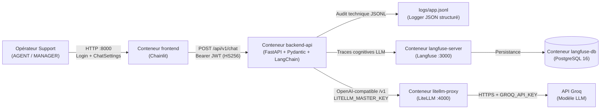

# Assistant Support Produit - Nexus Platform

Un assistant destiné aux agents (`AGENT`) et responsables (`MANAGER`) du support technique de **Nexus Platform**, conçu avec une gouvernance **Human-in-the-Loop** (validation humaine obligatoire avant toute communication externe), une architecture **multi-conteneurs isolée** et une **double observabilité** (système et cognitive).

Il repose sur :

- **Chainlit** : interface conversationnelle opérateur avec authentification par rôle, sélecteurs de contexte ticket (`Client ID`, `Sévérité`), panneau latéral de gouvernance et boutons d'action humaine.
- **FastAPI + Pydantic + LangChain** : microservice Backend API sécurisé par jetons JWT (HS256) / Bearer Token, validation stricte des contrats d'entrée/sortie et gestion de la mémoire par session.
- **LiteLLM Proxy** : passerelle d'inférence LLM dédiée découplant le backend du fournisseur externe (**Groq**).
- **Loguru (JSONL) + Langfuse Auto-Hébergé (PostgreSQL)** : double niveau d'observabilité associant journalisation technique structurée (`logs/app.jsonl`) et traçabilité cognitive LLM (`Langfuse` self-hosted).
- **Docker Compose + Makefile + `uv`** : déploiement reproductible en une commande et gestion déterministe des dépendances Python 3.12+.

---

## 1. Architecture et structure du projet

### Architecture multi-conteneurs et flux d'une requête



### Arborescence du dépôt

```txt
llmops-support-produit/
├── .chainlit/                  # Configuration de l'interface Chainlit
├── .dockerignore               # Exclusions pour la construction des images Docker
├── .env.example                # Modèle des variables d'environnement (à copier vers .env)
├── chainlit.md                 # Page d'accueil Markdown de l'interface Chainlit
├── docker-compose.yml          # Orchestration des 5 services + conteneur de tests
├── Makefile                    # Commandes d'automatisation (setup, build, up, tests, logs...)
├── pyproject.toml              # Dépendances Python par groupe (backend, frontend, dev) gérées par uv
├── uv.lock                     # Fichier de verrouillage déterministe uv
├── litellm/
│   └── config.yaml             # Configuration du routeur LiteLLM Proxy vers Groq
├── logs/
│   └── app.jsonl               # Traces techniques du Logger JSON structuré (Niveau 1)
├── donnees/                    # Corpus documentaire Markdown, tables CSV et jeu d'évaluation
│   ├── donnees_tabulaire/      # clients.csv, known_issues.csv, product_versions.csv, sla_matrix.csv, tickets.csv
│   ├── jeux_evaluation/        # eval_tickets.csv
│   └── sources_documentaires/  # Guides d'installation v2/v3, API reference, FAQ, Release notes
├── src/
│   ├── backend/
│   │   ├── Dockerfile.backend  # Image Docker du microservice FastAPI
│   │   ├── api/
│   │   │   ├── dependencies.py # Dépendances FastAPI (auth Bearer/JWT, exécution sécurisée LLM)
│   │   │   └── main.py         # Routes HTTP (/health, /api/v1/auth/*, /api/v1/chat, /api/v1/history/*)
│   │   ├── core/
│   │   │   ├── chains.py       # Orchestration LangChain et assemblage du contexte
│   │   │   ├── config.py       # Configuration centralisée via pydantic-settings
│   │   │   ├── constants.py    # Référentiel des clients autorisés (CLI-001 à CLI-015) et sévérités
│   │   │   ├── llm.py          # Client ChatOpenAI pointant vers LiteLLM Proxy
│   │   │   ├── schemas.py      # Contrats Pydantic d'entrée/sortie et garde-fous métiers
│   │   │   └── security.py     # Authentification opérateur, signature/vérification JWT HS256 et Bearer
│   │   ├── memory/
│   │   │   └── session_memory.py # Mémoire conversationnelle en RAM isolée par session (thread-safe)
│   │   ├── observability/
│   │   │   ├── langfuse_client.py # CallbackHandler et traçabilité cognitive Langfuse
│   │   │   └── logger.py       # Logger JSON structuré (Loguru -> logs/app.jsonl)
│   │   └── prompts/
│   │       └── support_prompts.py # Prompts système et templates conversationnels
│   └── frontend/
│       ├── Dockerfile.frontend # Image Docker de l'interface Chainlit
│       └── app.py              # Application Chainlit (auth, ChatSettings, ElementSidebar, actions)
└── tests/                      # Suite de tests unitaires et d'intégration (pytest)
    ├── Dockerfile.test         # Image Docker dédiée à l'exécution des tests
    ├── conftest.py             # Fixtures partagées
    ├── test_api.py             # Tests du contrat Pydantic, des routes FastAPI et des erreurs
    ├── test_auth_and_memory.py # Tests JWT HS256, rôles opérateurs et mémoire de session
    ├── test_container_integration.py # Tests d'intégration inter-conteneurs Docker
    └── test_frontend.py        # Tests unitaires de l'interface Chainlit
```

---

## 2. Prérequis

| Outil | Rôle | Commande de vérification |
|---|---|---|
| **Docker Engine + Docker Compose v2** | Conteneurisation et orchestration des 5 services applicatifs | `docker --version && docker compose version` |
| **GNU Make** | Exécution des commandes d'automatisation du projet | `make --version` |
| **`uv`** (Python $\ge$ 3.12) | Gestionnaire de paquets et d'environnement virtuel Python | `uv --version` |
| **Clé API Groq** | Accès au modèle de langage via la passerelle `litellm-proxy` | [https://console.groq.com/keys](https://console.groq.com/keys) |

---

## 3. Installation et configuration

### Étape 1 - Initialiser l'environnement local

La commande `make setup` crée automatiquement le fichier `.env` (à partir de `.env.example`), prépare le répertoire `logs/` et synchronise l'environnement virtuel Python via `uv sync` :

```bash
make setup
```

*(Alternative manuelle pour copier uniquement le fichier d'environnement : `cp .env.example .env`)*

### Étape 2 - Configurer le fichier `.env`

Le fichier `.env` contient les secrets de l'application et n'est jamais versionné ni copié dans les images Docker.

1. **Renseigner votre clé API Groq** dans `.env` :
   ```env
   GROQ_API_KEY=gsk_votre_cle_groq_ici
   ```
2. **(Recommandé) Générer des secrets cryptographiques forts** pour les jetons JWT et Chainlit :
   ```bash
   python3 -c 'import secrets; print("JWT_SECRET_KEY=" + secrets.token_hex(32)); print("CHAINLIT_AUTH_SECRET=" + secrets.token_hex(32))'
   ```

#### Récapitulatif des principales variables du fichier `.env`

| Variable | Obligatoire | Description | Valeur par défaut (`.env.example`) |
|---|---|---|---|
| `GROQ_API_KEY` | **Oui** | Clé API Groq utilisée par le conteneur `litellm-proxy` | `gsk_votre_cle_groq_ici` |
| `GROQ_MODEL_NAME` | Non | Modèle cible appelé sur Groq par LiteLLM | `groq/openai/gpt-oss-20b` |
| `LITELLM_MASTER_KEY` | **Oui** | Clé maîtresse sécurisant les appels vers `litellm-proxy` | `sk-nexus-litellm-master-key-v1` |
| `LITELLM_MODEL_NAME` | Non | Alias du modèle exposé par LiteLLM au backend | `nexus-support-llm` |
| `API_SECRET_TOKEN` | **Oui** | Jeton Bearer statique accepté par le Backend API | `nexus-v1-secret-bearer-token-2026` |
| `JWT_SECRET_KEY` | **Oui** | Clé secrète de signature des jetons JWT (HS256) | `nexus-v1-jwt-hs256-secret-key-2026-change-me` |
| `JWT_EXPIRE_MINUTES` | Non | Durée de validité des jetons JWT (en minutes) | `60` |
| `CHAINLIT_AUTH_SECRET` | **Oui** | Secret de signature des sessions d'authentification Chainlit | `nexus-chainlit-auth-secret-key-v1-2026-change-me` |
| `AGENT_USERNAME` / `AGENT_PASSWORD` | **Oui** | Identifiants de l'opérateur ayant le rôle `AGENT` | `agent` / `agent-pass` |
| `MANAGER_USERNAME` / `MANAGER_PASSWORD` | **Oui** | Identifiants du responsable ayant le rôle `MANAGER` | `manager` / `manager-pass` |
| `LOG_FILE_PATH` | Non | Chemin du fichier de journalisation JSON structurée | `logs/app.jsonl` |
| `LANGFUSE_ENABLED` | Non | Active l'envoi des traces cognitives vers Langfuse | `true` |
| `LANGFUSE_PUBLIC_KEY` / `LANGFUSE_SECRET_KEY` | Non | Clés d'API du projet Langfuse initialisé automatiquement | `pk-lf-local-nexus` / `sk-lf-local-nexus` |

> [!NOTE]
> Dans Docker Compose, les URLs de communication inter-conteneurs (`BACKEND_API_URL=http://backend-api:8080`, `LITELLM_PROXY_URL=http://litellm-proxy:4000/v1`, `LANGFUSE_HOST=http://langfuse-server:3000`) sont automatiquement injectées sur le réseau interne `nexus-net`.

### Étape 3 - Construire et démarrer l'ensemble des services

Déployez toute l'architecture en une seule commande :

```bash
make all
```

Vérifiez ensuite que tous les conteneurs sont démarrés et en état `healthy` :

```bash
make ps
```

---

## 4. Utilisation

### 4.1. Services, ports et identifiants par défaut

Une fois `make up` (ou `make all`) exécuté, les services suivants sont accessibles localement :

| Service | Rôle | URL locale | Identifiants par défaut |
|---|---|---|---|
| **Frontend Chainlit** | Interface conversationnelle Opérateur Support | [http://localhost:8000](http://localhost:8000) | • Profil **Agent** : `agent` / `agent-pass`<br/>• Profil **Manager** : `manager` / `manager-pass` |
| **Backend API (Swagger)** | Documentation interactive OpenAPI du microservice FastAPI | [http://localhost:8080/docs](http://localhost:8080/docs) | Header `Authorization: Bearer <JWT ou API_SECRET_TOKEN>` |
| **LiteLLM Proxy** | Passerelle d'inférence LLM vers Groq | [http://localhost:4000](http://localhost:4000) | Clé : `sk-nexus-litellm-master-key-v1` |
| **Langfuse Auto-Hébergé** | Interface web d'observabilité cognitive LLM | [http://localhost:3000](http://localhost:3000) | • Email : `admin@nexus-local.internal`<br/>• Mot de passe : `nexus-admin-local-pass` |

### 4.2. Utiliser l'interface Opérateur Support (Chainlit)

1. **Connexion :** Ouvrez [http://localhost:8000](http://localhost:8000) et connectez-vous avec le compte `agent` (`agent-pass`) ou `manager` (`manager-pass`). Un jeton JWT signé (HS256) est automatiquement émis pour votre session.
2. **Configuration du contexte ticket (`ChatSettings`) :** Cliquez sur l'icône des paramètres dans la barre de saisie pour sélectionner :
   - Le **Client ID** parmi la liste autorisée (`CLI-001` à `CLI-015`).
   - Le **Niveau de sévérité** du ticket (`LOW`, `MEDIUM`, `HIGH`, `CRITICAL`).
3. **Traitement de la demande :** Saisissez la question ou le problème technique soumis par le client.
4. **Inspection du panneau latéral (`ElementSidebar`) :** À chaque réponse, le volet latéral droit affiche :
   - Le profil de l'opérateur connecté (`AGENT` ou `MANAGER`),
   - Le contexte actif du ticket (`client_id`, `severity`, `product_version`, `sla_level`),
   - Les indicateurs de gouvernance (`requires_human_validation`, `escalation_required`),
   - L'identifiant unique de trace (`trace_id`) reliant le Logger JSON et Langfuse.
5. **Validation humaine obligatoire (*Human-in-the-Loop*) :** Sous chaque réponse de l'assistant, utilisez les boutons d'action :
   - **Valider la réponse (Envoi Client)** : confirme la relecture humaine de la proposition.
   - **Escalader au Manager Support (N2)** : signale qu'une prise en charge par un responsable support est requise.

### 4.3. Interroger directement l'API Backend (Swagger `/docs` ou `curl`)

#### Via l'interface Swagger ([http://localhost:8080/docs](http://localhost:8080/docs))

1. Dépliez `POST /api/v1/auth/login`, cliquez sur **Try it out** et exécutez la requête avec `{"username": "agent", "password": "agent-pass"}`.
2. Copiez la valeur de `access_token` dans la réponse JSON (ou utilisez la valeur de `API_SECRET_TOKEN` définie dans `.env`).
3. Cliquez sur le bouton **Authorize** en haut à droite de la page Swagger, collez le jeton et validez.
4. Vous pouvez désormais tester `GET /api/v1/auth/me`, `POST /api/v1/chat`, `GET /api/v1/history/{session_id}` et `DELETE /api/v1/history/{session_id}`.

#### Via `curl` en ligne de commande

```bash
# 1. Obtenir un jeton JWT signé (HS256)
TOKEN=$(curl -s -X POST http://localhost:8080/api/v1/auth/login \
  -H "Content-Type: application/json" \
  -d '{"username": "agent", "password": "agent-pass"}' | python3 -c "import sys, json; print(json.load(sys.stdin)['access_token'])")

# 2. Envoyer une requête support sur /api/v1/chat
curl -s -X POST http://localhost:8080/api/v1/chat \
  -H "Authorization: Bearer $TOKEN" \
  -H "Content-Type: application/json" \
  -d '{
    "session_id": "sess-demo-01",
    "operator_id": "agent",
    "operator_role": "AGENT",
    "client_id": "CLI-003",
    "severity": "MEDIUM",
    "message": "Le service plante au démarrage avec ImportError: cannot import name DataConnector.",
    "history": []
  }' | python3 -m json.tool

# 3. Consulter l'historique de la session
curl -s -X GET http://localhost:8080/api/v1/history/sess-demo-01 \
  -H "Authorization: Bearer $TOKEN" | python3 -m json.tool
```

### 4.4. Commandes du `Makefile`

| Commande | Description |
|---|---|
| `make help` | Affiche l'aide listant toutes les commandes disponibles |
| `make setup` | Initialise `.env`, crée le dossier `logs/` et synchronise l'environnement via `uv sync` |
| `make all` | Construit les images Docker puis démarre l'ensemble des services (`build` + `up`) |
| `make build` | Construit les images Docker des services via Docker Compose |
| `make up` / `make start` | Démarre l'ensemble des conteneurs en arrière-plan et affiche leurs URLs |
| `make down` / `make stop` | Arrête et supprime les conteneurs Docker actifs |
| `make rebuild` | Arrête, reconstruit les images et redémarre tous les services |
| `make restart` | Redémarre complètement tous les conteneurs Docker (`down` + `up`) |
| `make ps` / `make status` | Affiche l'état des conteneurs et de leurs sondes de santé (`healthcheck`) |
| `make logs` | Affiche les journaux Docker en temps réel de tous les services (`Ctrl+C` pour quitter) |
| `make logs-json` | Affiche les traces techniques locales du Logger JSON structuré (`logs/app.jsonl`) |
| `make test` | Exécute la suite de tests unitaires et fonctionnels localement via `uv run pytest -v` |
| `make tests` | Exécute les tests unitaires et d'intégration dans le conteneur dédié Docker (`tests`) |
| `make clean` | Nettoie les caches Python/pytest (`.pytest_cache`, `__pycache__`) et les conteneurs orphelins |

---

## 5. Référence des endpoints API et gestion des erreurs

### Routes exposées par `backend-api` (Port `8080`)

Toutes les routes métiers (à l'exception de `/health` et `/api/v1/auth/login`) exigent l'en-tête `Authorization: Bearer <TOKEN>` (jeton JWT HS256 ou `API_SECRET_TOKEN`).

| Méthode | Endpoint | Authentification | Schéma d'entrée | Schéma de sortie / Réponse |
|---|---|---|---|---|
| `GET` | `/health` | Publique | - | `{"status": "ok", "service": "nexus-support-backend-api", "version": "1.0.0-baseline"}` |
| `POST` | `/api/v1/auth/login` | Publique | `LoginRequest` (`username`, `password`) | `TokenResponse` (`access_token`, `token_type`, `operator_id`, `operator_role`) |
| `GET` | `/api/v1/auth/me` | Bearer / JWT | - | `OperatorUser` (`username`, `role`) |
| `POST` | `/api/v1/chat` | Bearer / JWT | `ChatRequest` (`session_id`, `operator_id`, `operator_role`, `client_id`, `severity`, `message`, `history`) | `ChatResponse` (`answer`, `client_context`, `sources`, `requires_human_validation`, `escalation_required`, `trace_id`) |
| `GET` | `/api/v1/history/{session_id}` | Bearer / JWT | `session_id` (path) | `HistoryResponse` (`session_id`, `history`) |
| `DELETE` | `/api/v1/history/{session_id}` | Bearer / JWT | `session_id` (path) | `{"status": "cleared", "session_id": "<session_id>"}` |

### Codes d'erreurs HTTP et garde-fous

| Code HTTP | Cas de déclenchement | Comportement et journalisation |
|---|---|---|
| `401 Unauthorized` | Identifiants opérateur invalides sur `/api/v1/auth/login` ou en-tête `Authorization: Bearer` manquant | Rejet immédiat sans appel au modèle LLM ; événement `auth_login_failed` ou `auth_missing_token` tracé dans `logs/app.jsonl`. |
| `403 Forbidden` | Jeton Bearer ou JWT invalide, altéré ou expiré | Rejet immédiat ; événement `auth_invalid_token` tracé dans `logs/app.jsonl`. |
| `422 Unprocessable Entity` | Violation du contrat d'entrée Pydantic : champ vide, rôle/sévérité inconnu, ou **client non reconnu hors de `CLI-001`..`CLI-015`** (ex. : `CLI-099`) | Garde-fou déterministe bloquant la requête avant toute invocation de LiteLLM / Groq ; événement `validation_error` tracé dans `logs/app.jsonl`. |
| `413` / `429` | Limite de taille de requête ou quota de requêtes atteint sur le fournisseur LLM (Groq) | Intercepté par `run_llm_safely` et journalisé avec le niveau `WARNING`. |
| `502 Bad Gateway` | Passerelle `litellm-proxy` ou API externe Groq injoignable / en erreur | Intercepté par `run_llm_safely`, journalisé dans `logs/app.jsonl` (`llm_gateway_error`) et restitué proprement à l'interface Chainlit. |

---

## 6. Observabilité (double niveau) et sécurité

### Niveau 1 - Observabilité système : Logger JSON structuré (`logs/app.jsonl`)

Chaque événement technique (connexion opérateur, réception d'un ticket, rejet d'authentification `401`/`403`, rejet de validation Pydantic `422` tel que `CLI-099`, erreur de passerelle LLM ou réponse validée `200`) est enregistré au format JSON Lines dans `logs/app.jsonl`.

Pour consulter les traces système :

```bash
make logs-json
```

Chaque entrée JSONL contient notamment : `timestamp`, `level`, `event`, `message`, `session_id`, `operator_id`, `operator_role`, `client_id`, `severity`, `trace_id`, `status_code` et `extra_data`.

### Niveau 2 - Observabilité cognitive : Langfuse Auto-Hébergé (`http://localhost:3000`)

Le conteneur `langfuse-server` (adossé à `langfuse-db` sous PostgreSQL 16) est préconfiguré automatiquement au démarrage avec le projet **Support Produit Nexus** (`pk-lf-local-nexus`).
- Chaque appel sur `POST /api/v1/chat` ouvre une trace cognitive corrélée au `trace_id`, au `session_id`, au `operator_id` et aux métadonnées du ticket (`client_id`, `severity`).
- Vous pouvez inspecter les prompts exacts envoyés au modèle, les réponses générées, la consommation de tokens et la latence d'inférence en vous connectant sur [http://localhost:3000](http://localhost:3000) (`admin@nexus-local.internal` / `nexus-admin-local-pass`).

### Sécurité et gouvernance *Human-in-the-Loop*

- **Découplage de l'inférence LLM :** Le service `backend-api` n'interroge jamais l'API Groq en direct ; il communique exclusivement avec le conteneur interne `litellm-proxy` (`http://litellm-proxy:4000/v1`), isolant ainsi la clé externe `GROQ_API_KEY`.
- **Responsabilité humaine systématique :** Le contrat de sortie `ChatResponse` maintient `requires_human_validation=True`. L'interface Chainlit accompagne chaque proposition de boutons de validation ou d'escalade, et journalise toute décision de l'opérateur.

---

## 7. Tests automatisés

Le projet dispose d'une suite de tests couvrant la sécurité (JWT HS256, Bearer Token, hachage et comparaison en temps constant), le contrat Pydantic (rejet de `CLI-099`, champs vides), la mémoire de session, le flux nominal mocké de `/api/v1/chat`, l'interface Chainlit et l'intégration conteneurisée.

### Exécution locale rapide (via `uv`)

```bash
make test
```

*(Équivalent à `uv run pytest -v` - exécute les tests unitaires et fonctionnels en local sans nécessiter d'appel externe à Groq).*

### Exécution complète dans le conteneur dédié Docker

```bash
make tests
```

Cette commande démarre `backend-api`, construit et lance le conteneur `tests` (qui active également les tests d'intégration réels inter-conteneurs avec `RUN_CONTAINER_TESTS=true`), puis arrête proprement `backend-api` à la fin de l'exécution.
